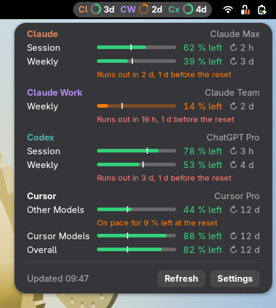
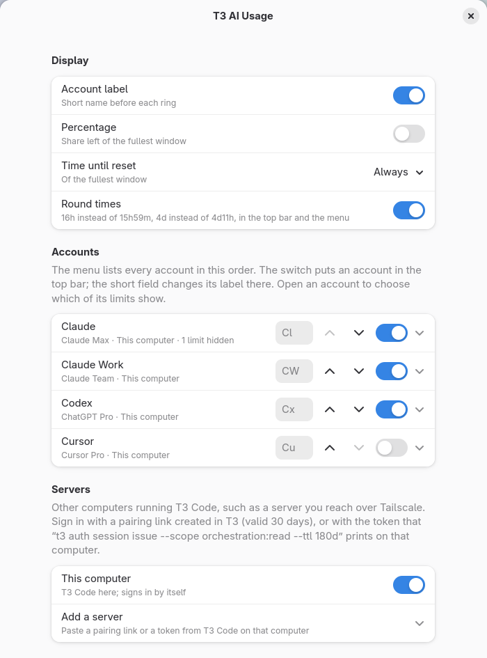

# T3 AI Usage

A GNOME Shell extension that shows the usage limits of every AI account in [T3 Code](https://github.com/pingdotgg/t3code) in the top bar. Unofficial: it is not affiliated with the T3 Code project.



T3 Code already checks the limits of every provider account it runs: Claude, Codex, Cursor, Antigravity and others. This extension reads them from T3 and shows:

- **Top bar:** a ring for each account, filled to the share left of its fullest limit, and the time until that limit resets.
- **Menu:** one line for every limit of every account: a bar whose marker shows where an even pace would be, the share left, and the time until the reset (↻). A limit on course to run short gets a second line ("Runs out in 2 d, 1 d before the reset"). On a short screen the list scrolls.
- **Settings:** the order of the accounts, which of them go in the top bar, their short labels, which limits to hide, and T3 servers on other computers.



## Requirements

- GNOME Shell 46, 48, 49, 50 or 51. Each is tested; 47 is not.
- T3 Code on this computer (the desktop app or `t3 serve`), or on another computer you can reach.

## Install

1. Download `t3-ai-usage@mawox.github.io.shell-extension.zip` from the [latest release](https://github.com/Mawox/t3-ai-usage/releases/latest).
2. Install it:

   ```sh
   gnome-extensions install --force t3-ai-usage@mawox.github.io.shell-extension.zip
   ```

3. Log out and back in. On Wayland, GNOME Shell finds new extensions only at login.
4. Turn it on:

   ```sh
   gnome-extensions enable t3-ai-usage@mawox.github.io
   ```

To update, install the new zip the same way and log in again.

## T3 servers

**This computer.** The extension finds the running T3 through `~/.t3/userdata/server-runtime.json` and signs in by itself. It runs `t3 auth session issue --scope orchestration:read --ttl 180d`, using the `t3` command that T3 Code installs in `~/.t3/bin` (or `t3` on your `PATH`), and renews the token a day before it runs out.

**Other computers**, such as a server you reach over Tailscale: open Settings, then Servers, then Add a server, and paste one of these:

- A pairing link from T3 on that computer, for example from `t3 pair --scope orchestration:read`. Paste it before it expires (5 minutes by default). The sign-in lasts 30 days, and the menu reminds you a week before it ends.
- The token that `t3 auth session issue --scope orchestration:read --ttl 180d --label "T3 AI Usage" --json` prints on that computer. It lasts 180 days.

If T3 printed the link for 127.0.0.1, also enter the address the server has for you, such as `https://server.tailnet.ts.net`. An account signed in on several servers appears once.

## Privacy

- The extension talks only to the T3 servers you set up and sends nothing anywhere else.
- Tokens are stored in `~/.config/t3-ai-usage/tokens/`, readable only by you.
- Give other computers an `https://` address, such as the one Tailscale Serve provides. Over plain `http://` the pairing code and the token cross the network unencrypted, unless the network itself encrypts them (as Tailscale does).
- The token has T3's `orchestration:read` scope, the narrowest one that can read the limits, and Settings refuses tokens with more rights. The same scope can also read your T3 threads; the extension calls only `server.getConfig` and `server.refreshProviders`. To revoke a token, run `t3 auth session list` and `t3 auth session revoke <id>` on that computer.

## Limitations

- The extension reads T3's WebSocket RPC, the internal interface the T3 app itself uses. It is not a public API, so a T3 update can break it; the menu then says that the T3 version is not supported. It was tested with T3 Code 0.1.7 and 0.1.8 nightly builds (November 2026). A public `t3 usage --json` command is proposed in [pingdotgg/t3code#30978](https://github.com/pingdotgg/t3code/discussions/30978).
- T3 checks limits every 5 minutes, but only while one of its windows is in the foreground. When its data is older, the extension asks T3 to check again, at most every 5½ minutes.

## Development

```sh
npm install
npm run lint
npm test          # needs gjs, the Soup 3 typelib and glib-compile-schemas
scripts/pack.sh   # builds dist/t3-ai-usage@mawox.github.io.shell-extension.zip
```

`tests/headless.sh OUTPUT_DIR` runs the extension in a headless GNOME Shell against `tests/mock-t3.js`, a stand-in T3 server with sample accounts, and saves a report and screenshots; `MONITOR=1728x420` in front of the command gives it a short screen, where the menu must scroll. It touches nothing outside a temporary directory. To test another GNOME version, run it in one of the containers in `tests/containers/` (Ubuntu 24.04, Debian 13, Fedora 43, Ubuntu 26.04):

```sh
docker build -t t3-ai-usage-test:ubuntu-24.04 -f tests/containers/ubuntu-24.04.Dockerfile tests/containers
docker run --rm -v "$PWD:/repo:ro" -v "$PWD/out:/out" t3-ai-usage-test:ubuntu-24.04 /repo/tests/headless.sh /out
```

On SELinux systems, add `,z` to both volume options. Pushing a `v*` tag builds the zip and publishes a GitHub release.

## License

GPL-2.0-or-later. See [LICENSE](LICENSE).
